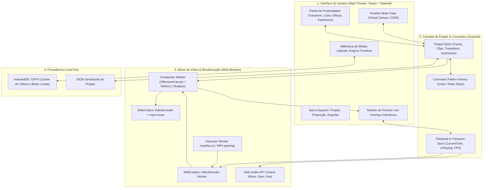

# Arquitetura Técnica — CineCut Studio

## 1. Visão Geral da Arquitetura

O CineCut Studio adota uma arquitetura em camadas orientada a eventos e processamento off-main-thread (Web Workers + WebCodecs + WebGL2). Isso garante que interações na interface (arrastar clipes na timeline, manipular sliders de cor, ajustar curvas de keyframes) permaneçam a 60-120 FPS sem travar o processamento de áudio e vídeo.



---

## 2. Decisões Tecnológicas e Justificativas

| Componente | Tecnologia Escolhida | Por que não a alternativa? |
|---|---|---|
| **Framework Base** | **Next.js 15 (App Router) + TypeScript** | Proporciona base estável, SSR para páginas de galeria/projetos, rotas de API prontas e suporte nativo a Turbopack. O editor roda com `"use client"`. |
| **Decode de Vídeo** | **WebCodecs API (`VideoDecoder`)** | Decodificação nativa por GPU do sistema operacional. Alternativas puras em WASM/FFmpeg consom 8x mais CPU e causam quedas de frame. |
| **Efeitos e Composição** | **WebGL2 (GLSL Shaders)** | Permite blend modes (Screen, Multiply, Add), correção de cor (LUTs, contrast, curves) e granulação em tempo real a 60 FPS com resolução 4K. |
| **Pipeline de Áudio** | **Web Audio API (`AudioContext`, `GainNode`)** | Mixagem precisa de múltiplas faixas, envelopes de volume, fade-in/fade-out e sincronização frame a frame sem descompasso. |
| **Muxer de Exportação** | **`mp4-muxer` + `WebCodecs VideoEncoder`** | Gera arquivos `.mp4` diretamente em memória e baixa instantaneamente, sem precisar enviar megabytes para a nuvem nem usar containers lentos de MediaRecorder. |
| **Gerenciamento de Estado** | **Zustand com Immer & Middleware de Histórico** | Extremamente leve, re-renderizações atômicas (seletores finos), sem o boilerplate do Redux e compatível com Command Pattern. |
| **Estilização** | **Tailwind CSS + Lucide Icons + Framer Motion** | Design profissional escuro (Dark Cinematic Mode), ergonomia visual padrão DaVinci/CapCut e micro-animações fluidas. |

---

## 3. Modelo de Dados do Projeto (Estrutura Principal)

A raiz do projeto é serializável em JSON puro, facilitando exportação, salvamento automático e replicação:

```typescript
export interface CineProject {
  id: string;
  name: string;
  version: "1.0.0";
  settings: {
    width: number;       // Ex: 1920 (ou 1080 para vertical)
    height: number;      // Ex: 1080 (ou 1920 para vertical)
    fps: 24 | 30 | 60;   // 24 para cinema, 30/60 para web
    duration: number;    // Duração total em segundos
  };
  tracks: Track[];
}

export interface Track {
  id: string;
  name: string;
  type: "video" | "audio" | "text" | "overlay";
  isMuted: boolean;
  isLocked: boolean;
  clips: Clip[];
}

export interface Clip {
  id: string;
  mediaId: string;
  type: "video" | "audio" | "image" | "text";
  startOnTimeline: number; // Início na linha do tempo (segundos)
  duration: number;        // Duração ativa na timeline
  trimStart: number;       // Ponto de entrada do clipe original
  trimEnd: number;         // Ponto de saída do clipe original
  
  // Transformações básicas e keyframes cenográficos
  transform: {
    x: number;
    y: number;
    scale: number;
    rotation: number;
    opacity: number;
    keyframes?: KeyframeTrack[]; // Interpolação estilo After Effects
  };

  // Efeitos Cenográficos
  effects: {
    blendMode: "normal" | "screen" | "multiply" | "overlay" | "add" | "color-dodge";
    colorGrade: {
      exposure: number;     // -100 a +100
      contrast: number;     // -100 a +100
      temperature: number;  // Warm / Cold (-100 a +100)
      tint: number;         // Magenta / Green
      saturation: number;   // 0 a 200
      lutUrl?: string;      // 3D LUT cinematográfica
    };
    cinematic: {
      filmGrain: number;        // 0 a 100
      chromaticAberration: number;
      vignette: number;
      glowIntensity: number;
    };
  };

  // Transições de entrada e saída
  transitions?: {
    in?: { type: "crossfade" | "slide-left" | "zoom" | "whip-pan"; duration: number };
    out?: { type: "crossfade" | "slide-right" | "zoom-out"; duration: number };
  };
}

export interface KeyframeTrack {
  property: "x" | "y" | "scale" | "rotation" | "opacity";
  keyframes: {
    time: number; // Tempo relativo ao início do clipe
    value: number;
    easing: "linear" | "ease-in" | "ease-out" | "ease-in-out" | "spring" | "bounce";
  }[];
}
```

---

## 4. Pipeline de Renderização Shader GLSL (Cenografia em Tempo Real)

Cada frame composto é processado por um pipeline de fragment shaders no WebGL2:

1. **Passo 1: Composição de Camadas (Layer Blending)**:
   - Renderiza a textura base da faixa inferior.
   - Aplica a faixa superior com o modo de mesclagem matemático selecionado:
     - `Screen`: `1.0 - (1.0 - base) * (1.0 - blend)` (perfeito para luzes e fogo cenográficos).
     - `Multiply`: `base * blend` (perfeito para sombras e texturas).
     - `Overlay`: Combina Multiply e Screen para contraste dinâmico.
2. **Passo 2: Color Grading Cinematográfico (Lumetri Engine)**:
   - Ajuste de matriz de cores para balanço de brancos (temperatura/matiz).
   - Ajuste de curvas de contraste e saturação RGB.
3. **Passo 3: Efeitos Atmosféricos**:
   - Ruído pseudo-randômico GLSL para emulação de película Kodak/Fuji (Film Grain).
   - Deslocamento de canais R e B nas bordas para Aberração Cromática.
   - Vignette circular suavizada para foco no elemento cenográfico principal.

---

## 5. Diretrizes de Performance Crítica

1. **Destruição Imediata de `VideoFrame`**:
   - Cada objeto `VideoFrame` alocado pela WebCodecs consome memória direta na VRAM da GPU.
   - Todo frame consumido pelo WebGL deve obrigatoriamente chamar `.close()` no mesmo ciclo de renderização para evitar crashes do navegador.
2. **Resolução de Preview Inteligente**:
   - Durante a reprodução em tempo real na tela, a textura de renderização pode rodar em 540p ou 720p (meia resolução), garantindo fluidez instantânea.
   - No momento da exportação final, o renderizador executa o pipeline em resolução total (1080p ou 4K nativo) frame a frame.
3. **Trabalhadores Isolados**:
   - O demuxer e o decodificador operam em workers dedicados usando `Transferable Objects` (zero-copy overhead).

